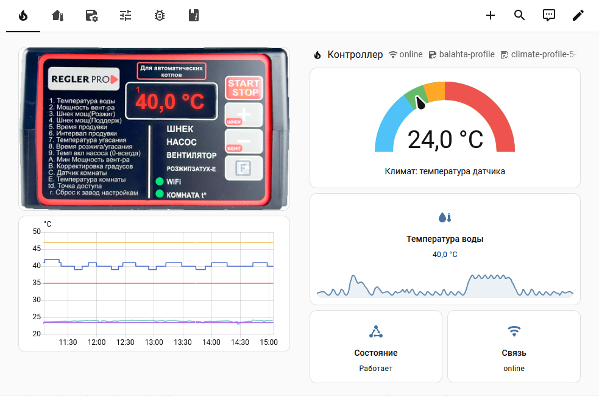

# ReglerPro Controller — интеграция для Home Assistant

[](https://hacs.xyz)


Кастомная интеграция Home Assistant для управления параметрами и регистрации показаний датчиков контроллера твердотопливного котла [ReglerPro](https://regler.pro/), работающая через облачный API веб-приложения производителя. Поддерживаются основной и резервные серверы ReglerPro, повторная авторизация при отклонении сохранённых учётных данных и скачиваемая диагностика с обезличиванием секретных данных.



*Рисунок. Пример дашборда контроллера ReglerPro Controller*

> **Неофициальный проект.** Интеграция не связана с производителем, но использует тот же API, что и веб-приложение. Управление котлом влияет на безопасность отопления: изменяйте уставки осознанно и не оставляйте автоматизации без контроля.

## Содержание

- [Возможности](#возможности)
- [Что нового](#что-нового)
- [Требования](#требования)
- [Установка](#установка)
- [Настройка](#настройка)
- [Сущности](#сущности)
- [Климат-контроль](#климат-контроль)
- [Профили настроек](#профили-настроек)
- [Пример дашборда](#пример-дашборда)
- [API](#api)
- [Диагностика и отладка](#диагностика-и-отладка)
- [Известные ограничения](#известные-ограничения)
- [Документация](#документация)

## Возможности

- **Сенсоры**: температура воды, уставки, состояние котла, температура шнека, онлайн/офлайн, режим климат-контроля.
- **Переключатель**: старт/стоп котла.
- **Слайдеры и поля ввода**: уставки температуры, вентилятор, продувка, шнек, коррекция, заслонка вентилятора, коррекция датчика температуры.
- **Термостат (`climate`)**: климат-контроль по датчику температуры помещения — постоянная температура и расписания 7/7, 5/2, 4/1/2.
- **Выбор датчика** климат-контроля и регистрация нового датчика температуры через настройки интеграции.
- **Расписание**: 48 числовых полей — время начала и температура периодов.
- **Диагностика**: аварии и ошибки, параметры шнека, версия прошивки, сводный сенсор со всеми разобранными параметрами и «сырой» строкой `params`.
- **Профили настроек**: отдельные профили **котла** и **климата** с независимым выбором, применением и откатом; переключение вручную, по расписанию и по событиям; экспорт и импорт в файл, загрузка файла профилей с устройства.
- **Проверка применения профиля**: сообщение называет неподтверждённые значения; используется `get_big_contr_check`, при необходимости выполняется одна повторная запись и проверка.
- **Безопасное применение профиля климата**: пока климат-контроль выключен, режим, цель, расписание и датчик не записываются; можно использовать `force=true`.
- **Подключение через `login_user` и `get_data_sets`**: проверка логина и пароля, выбор дома из списка домов учётной записи, проверка принадлежности введённого номера дома.
- **Серверы**: основной и резервные адреса, автоматический переход при сбое; команды, которые могли быть выполнены, не отправляются повторно на другой сервер.
- **Повторная авторизация**: при отказе сервера можно обновить пароль, не удаляя и не добавляя интеграцию заново.
- **Проверка ID датчика**: формат идентификатора ограничен 8–20 цифрами.
- **Надёжная работа платформ Home Assistant**: данные клиента API и координатора хранятся в `entry.runtime_data`; команды сущностей одной платформы выполняются последовательно через `PARALLEL_UPDATES`; службы регистрируются при загрузке интеграции в `async_setup`.
- **Корректный статус связи**: контроллер считается онлайн не только при `mqtt_online = 1`, но и при `mqtt_online = 0`, если с обрыва прошло меньше 600 секунд; порог «в сети» для датчика — 1800 секунд.
- **Устойчивый опрос**: один испорченный элемент списка устройств не останавливает опрос остальных.
- **Дашборд**: YAML-пример панели с настройками котла и диагностикой; изображения вариантов оформления — в `dashboards/example/`.
- **Диагностика**: скачиваемый отчёт с сокрытием логина, пароля, ID дома и идентификаторов устройств.
- **Иконка и логотип** интеграции для HACS и Home Assistant (папка `brand/`).

## Что нового

### 1.7.1

- Закрыты находки 79 и 80.
- Числа котла становятся **недоступными**, если приложение ReglerPro показывает соответствующий параметр иначе:
  - шнек (`shn_roz_vkl`, `shn_roz`, `shn_uga_vkl`, `shn_uga`) — только у «авто»-котлов;
  - `vent_min` — только у остальных котлов;
  - «Коррекция t° воды» (`korect_`) и «Время угасания» (`time_ugas`) — только если `korect_20 > 0`;
  - `servo_cooler` — только при ненулевом значении;
  - остальные — если значение пришло от контроллера.
- Значение недоступного числа остаётся в состоянии, поэтому автоматизации продолжают его читать. Правила не затрагивают числа расписания.
- Добавлены два числа:
  - **«Заслонка вентилятора»** (`servo_cooler`) — 1–99 %;
  - **«Коррекция датчика температуры»** (`korect_dt`) — −15…15 °C с шагом 0,5, у каждого датчика.
- `korect_dt` записывается без сдвига на 20, как в приложении; у `korect_` сдвиг остаётся.
- В аудите добавлено наблюдение 83: в приложении кнопка «Климат» скрыта для прошивки `vers = 201742`. В Home Assistant климатические сущности у такого контроллера остаются, но могут ничего не показывать.

### 1.7.0

- Окно подключения проверяет вход запросом `login_user`, как в приложении.
- Дома берутся запросом `get_data_sets`:
  - один дом выбирается сам;
  - несколько домов дают список «название (номер)»;
  - введённый вручную номер должен быть среди домов учётной записи;
  - если домов нет, показывается сообщение «У этой учётной записи нет домов»;
  - если список домов получить не удалось, остаётся ручной ввод номера.
- Повторная авторизация проверяет только логин и пароль, без запроса устройств.
- Название записи содержит название дома. Данные записи (`url`, `login`, `password`, `home_id`) не изменились.
- Номера домов могут быть отрицательными — проверка «только цифры» для них не применяется.

### 1.6.2

- Закрыта находка 55: значения областей «режим и цель», «расписание» и «датчик» профиля климата не записываются, пока климат-контроль выключен.
- Применение профиля климата при выключенном климате сообщает: «Профиль применён не полностью… климат-контроль выключен: включите его и примените профиль снова». Значения котла при этом применяются.
- Пробный запуск (`dry_run`) показывает такие значения как пропущенные.
- Если нет актуальных данных климат-контроля, причина называется иначе: «нет актуальных данных климат-контроля, повторите позже».
- `force=true` отключает проверку состояния климата для `apply_profile` и `undo_apply`.

### 1.6.1

- Сверка клиента API с `functions.js`:
  - максимум для `shn_roz_vkl` и `shn_uga_vkl` — 600;
  - порог «в сети» у датчика — 1800 секунд;
  - контроллер считается онлайн при `mqtt_online = 1` или при `mqtt_online = 0`, если с обрыва прошло меньше 600 секунд;
  - один испорченный элемент списка не останавливает опрос остальных устройств.
- При неподтверждённом применении профиля сообщение называет значения: «boiler.temp_w_min (ожидалось 35, получено 40)».
- Для проверки записи используется `get_big_contr_check`; неподтверждённые параметры котла записываются ещё один раз и проверяются снова.

### 1.6.0

- Клиент API и координатор хранятся в `entry.runtime_data`.
- Для платформ управления задан `PARALLEL_UPDATES = 1`, для `sensor` — `0`.
- Менеджер профилей и все 9 служб создаются один раз при загрузке интеграции в `async_setup`.
- Без загруженной записи службы отвечают понятной ошибкой, а не падают с `KeyError`.
- Окно «Добавить датчик» у незагруженной записи завершается сообщением `not_loaded`.

Полный список изменений: [RELEASE_NOTES.md](./RELEASE_NOTES.md).

## Требования

- Home Assistant **2026.3.0 и новее** (нужно для иконок из папки `brand/`).
- Учётная запись на [app.reglerpro.ru](https://app.reglerpro.ru) и подключённый к ней контроллер.
- Внешние Python-зависимости не требуются.

## Установка

### Через HACS

1. Добавьте репозиторий https://github.com/dmitry-reva/reglerpro-controller в HACS как Custom Repository (категория Integration).
2. Установите интеграцию.
3. Перезапустите Home Assistant.
4. Настройки → Устройства и службы → Добавить → ReglerPro Controller.

> Начиная с версии 1.4.1 HACS скачивает `kotel.zip` из GitHub Releases (`zip_release` в `hacs.json`). Архив собирается автоматически workflow `Release zip`; вручную его готовить не нужно. Если релиз опубликован без asset `kotel.zip`, HACS сообщит об ошибке загрузки.

### Установка вручную

1. Скопируйте папку `custom_components/kotel/` в `/config/custom_components/`.
2. Перезапустите Home Assistant.
3. Настройте через UI.

> Домен интеграции — `kotel`: он совпадает с именем папки и указывается в `manifest.json`.

Подробнее: [docs/INSTALLATION.md](./docs/INSTALLATION.md).

## Настройка

| Параметр | Описание | По умолчанию |
|----------|----------|-------------|
| URL | Адрес сервера | `https://app.reglerpro.ru/` |
| Логин | Ваш логин | — |
| Пароль | Ваш пароль | — |
| ID дома | Идентификатор дома | пусто |
| Интервал | Частота опроса, сек (10–300) | 30 (см. [ограничения](#известные-ограничения)) |

Порядок подключения:

1. Укажите сервер, логин и пароль. Номер дома необязателен.
2. Интеграция проверяет вход запросом `login_user`, как в приложении. Если сервер отклоняет вход и поясняет причину, текст показывается в ошибке; он очищается от разметки и от логина с паролем. Если пояснения нет, остаётся «Неверный логин или пароль».
3. Дома берутся запросом `get_data_sets`:
   - один дом выбирается сам;
   - несколько домов дают список «название (номер)»;
   - введённый вручную номер должен быть среди ваших домов, иначе будет ошибка «этого номера нет среди домов учётной записи» со списком ваших домов;
   - если домов нет, сообщение «У этой учётной записи нет домов»;
   - если список домов получить не удалось, остаётся поле для ручного ввода номера.
4. Повторная авторизация проверяет только логин и пароль, без запроса устройств.

**ID дома** можно оставить пустым, если сервер возвращает список устройств по логину и паролю. Если после ввода данных появляется ошибка «нужен ID дома», укажите его. Номера домов могут быть отрицательными.

## Сущности

Базовые сенсоры (температура, состояние, связь, уставки, активные профили) создаются для каждого контроллера. **Диагностические** сенсоры создаются только если контроллер отдаёт соответствующий параметр; если при запуске контроллер был офлайн, создаются все возможные. Полный каталог с `unique_id`, категориями и состояниями — **[docs/ENTITIES.md](./docs/ENTITIES.md)**.

В интерфейсе имя сущности состоит из имени устройства и названия: «Kotel контроллер · Температура воды». `entity_id` зависит от имени устройства и создаётся один раз; при обновлении он не меняется.

### Датчики и состояние

| Сущность | Описание |
|---|---|
| Температура воды | текущая температура теплоносителя |
| Уставки температуры (max / min) | сенсоры уставок |
| Температура шнека | для автоматических котлов |
| Состояние | Остановлен / Работает / Розжиг/Угасание |
| Статус подключения | `online` / `offline` |
| Климат-контроль | Нагрев / Охлаждение / Выключен |
| Датчик температуры (`dt`) | температура и время последнего обновления |

### Диагностика (категория «Диагностика»)

| Группа | Параметры |
|---|---|
| Прошивка и вентилятор | версия прошивки, вентилятор включён |
| Аварии и ошибки | тревога по воде, авария шнека, ошибки датчиков воды и шнека, ошибка симистора (отображаются как «нет» / «да») |
| Шнек (авто-котлы) | интервалы и время работы при нагреве и поддержании, автореверс |
| Климат | значения из климат-контроля: включён, датчик выбран, имя датчика, температура датчика, целевая температура, период |
| Выносной датчик | использование и температура (строковый формат `params`) |
| Сводный | **«Диагностика параметров»**: все разобранные параметры и исходная строка `params` в атрибутах |

### Управление

| Платформа | Сущности |
|---|---|
| `switch` | Старт/Стоп |
| `number` | уставки max и min, температура насоса, коррекция температуры, время и интервал продувки, вентилятор min и max, время угасания, интервалы шнека, заслонка вентилятора, коррекция датчика температуры |
| `climate` | «Термостат» |
| `select` | «Датчик климат-контроля» |
| `number` (расписание) | 48 полей: время начала и температура для 4 периодов в 6 наборах расписания |
| `select`, `text`, `button` | управление профилями котла и климата |

### Доступность чисел котла

Числа котла становятся недоступными, если приложение ReglerPro показывает этот параметр иначе. Значение недоступного числа остаётся в состоянии, поэтому автоматизации его по-прежнему читают.

| Параметр | Когда доступен |
|---|---|
| Шнек (`shn_roz_vkl`, `shn_roz`, `shn_uga_vkl`, `shn_uga`) | только у «авто»-котлов |
| `vent_min` | только у остальных котлов |
| «Коррекция t° воды» (`korect_`) и «Время угасания» (`time_ugas`) | только если `korect_20 > 0` |
| `servo_cooler` | только при ненулевом значении |
| Остальные | если значение пришло от контроллера |

Числа расписания эти правила не затрагивают.

## Климат-контроль

Климат-контроль управляет котлом по температуре помещения. Он работает с выбранным датчиком и либо поддерживает постоянную температуру, либо следует расписанию.

| Состояние контроллера | Режим термостата | Пресет |
|---|---|---|
| выключен | `off` | — |
| режим 0 (постоянная температура) | `heat` | — |
| режимы 3, 4, 5 (расписание) | `auto` | «Расписание 7/7», «Расписание 5/2», «Расписание 4/1/2» |

- Целевая температура: **5–40 °C с шагом 0,5**. В режиме расписания она только для чтения.
- Действие термостата: нагрев (`tstatNow = 0`) или охлаждение (`tstatNow = 1`).
- Включение и выключение на сервере работает как переключатель, поэтому перед командой интеграция обновляет данные и отправляет её, только если состояние нужно изменить. Команды одного термостата выполняются строго по очереди.
- Значения расписания меняются через `number`-сущности. Границы времени зависят от соседних периодов: период начинается позже предыдущего и раньше следующего.
- Пока климат-контроль выключен, профиль климата не записывает режим, цель, расписание и датчик. Кнопка сообщает, что профиль применён не полностью; значения котла применяются. Для принудительного применения можно использовать `force=true`.

Пример:

```yaml
action: climate.set_preset_mode
target:
  entity_id: climate.kotel_kontroller_termostat   # ID у вас может отличаться
data:
  preset_mode: "Расписание 5/2"